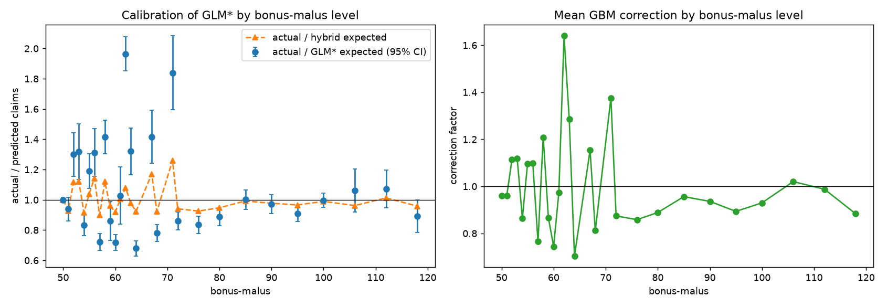

# Frequency: is there a bonus-malus saw-tooth the GLM's splines miss?

Data: **real freMTPL2 (public)**. Levels shown have at least 1627 policies.

## A. Calibration and GBM correction by bonus-malus level (held-out predictions, all folds)

|   bonus_malus_c |   policies |    claims |   actual_vs_glm_star |   actual_vs_hybrid |   mean_correction |
|----------------:|-----------:|----------:|---------------------:|-------------------:|------------------:|
|          50.000 | 384156.000 | 18010.000 |                1.000 |              1.000 |             0.959 |
|          51.000 |  15869.000 |   540.000 |                0.939 |              0.927 |             0.960 |
|          52.000 |   4770.000 |   315.000 |                1.300 |              1.119 |             1.114 |
|          53.000 |   3351.000 |   198.000 |                1.317 |              1.122 |             1.119 |
|          54.000 |  17360.000 |   610.000 |                0.831 |              0.915 |             0.865 |
|          55.000 |   5593.000 |   414.000 |                1.190 |              1.039 |             1.097 |
|          56.000 |   3453.000 |   266.000 |                1.312 |              1.143 |             1.099 |
|          57.000 |  17938.000 |   666.000 |                0.721 |              0.898 |             0.765 |
|          58.000 |   5970.000 |   618.000 |                1.415 |              1.121 |             1.209 |
|          59.000 |   2779.000 |   171.000 |                0.860 |              0.960 |             0.866 |
|          60.000 |  17363.000 |   755.000 |                0.718 |              0.919 |             0.744 |
|          61.000 |   1724.000 |   114.000 |                1.028 |              1.005 |             0.972 |
|          62.000 |   7180.000 |  1153.000 |                1.964 |              1.079 |             1.640 |
|          63.000 |   3169.000 |   285.000 |                1.320 |              0.977 |             1.286 |
|          64.000 |  18192.000 |   687.000 |                0.679 |              0.924 |             0.704 |
|          67.000 |   2782.000 |   253.000 |                1.416 |              1.170 |             1.154 |
|          68.000 |  18791.000 |   753.000 |                0.781 |              0.924 |             0.812 |
|          71.000 |   2056.000 |   219.000 |                1.840 |              1.260 |             1.375 |
|          72.000 |  18580.000 |   823.000 |                0.862 |              0.941 |             0.874 |
|          76.000 |  18226.000 |   816.000 |                0.835 |              0.926 |             0.858 |
|          80.000 |  18086.000 |   892.000 |                0.889 |              0.948 |             0.889 |
|          85.000 |  16887.000 |   934.000 |                1.001 |              0.992 |             0.956 |
|          90.000 |  16585.000 |   938.000 |                0.971 |              0.977 |             0.936 |
|          95.000 |  16726.000 |  1114.000 |                0.910 |              0.966 |             0.894 |
|         100.000 |  19530.000 |  1721.000 |                0.997 |              0.990 |             0.930 |
|         106.000 |   1670.000 |   218.000 |                1.062 |              0.962 |             1.020 |
|         112.000 |   1703.000 |   286.000 |                1.073 |              1.013 |             0.988 |
|         118.000 |   1647.000 |   269.000 |                0.892 |              0.959 |             0.883 |

A smooth risk gradient gives a smooth curve in the left panel; isolated levels far from 1 (with intervals excluding 1) indicate level-specific effects. Poisson CI = 1.96/sqrt(claims).

## B. Nested 5-fold CV: GLM* + one indicator per BM level (about 23 indicators per fold)

| model       |   mean_deviance |   share_of_gbm_gap_closed |
|:------------|----------------:|--------------------------:|
| glm_star    |         0.30948 |                   0.31449 |
| glm_star_bm |         0.30728 |                   0.50212 |
| hybrid      |         0.30173 |                   0.97355 |
| gbm         |         0.30142 |                   1.00000 |

Adding the BM-level indicators to GLM*: gain +0.00221 per fold (SD 0.00014, better in 5/5 folds) -> **clearly helps** (rule: mean gain larger than its fold-to-fold SD).

Caveat: the saw-tooth was spotted in held-out predictions from these same folds, so B is optimistic; treat it as an upper bound.
