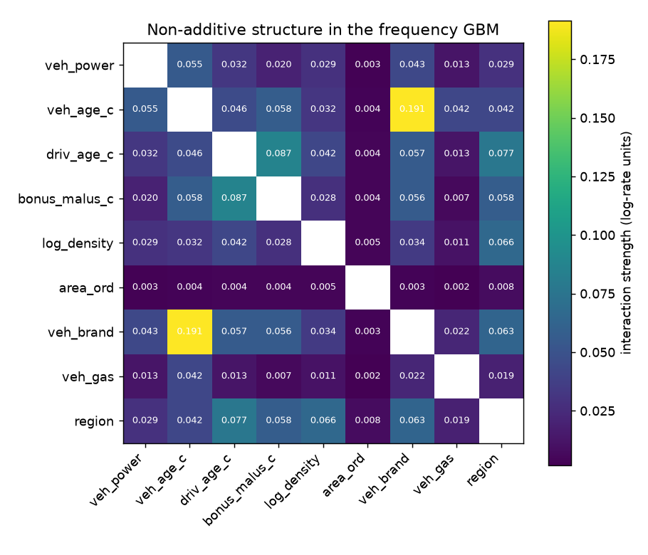
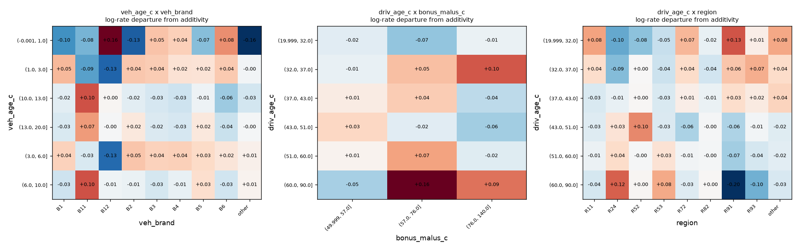

# Frequency GBM: which interactions does it use?

Data: **real freMTPL2 (public)**; 800 validation policies (no test data used). All quantities are on the log-rate scale: 0.05 means roughly a 5% departure in claim frequency.

## Pairs ranked by non-additive strength

| pair                       |   strength |     h2 |
|:---------------------------|-----------:|-------:|
| veh_age_c x veh_brand      |     0.1914 | 0.2898 |
| driv_age_c x bonus_malus_c |     0.0869 | 0.0518 |
| driv_age_c x region        |     0.0767 | 0.1479 |
| log_density x region       |     0.0659 | 0.1998 |
| veh_brand x region         |     0.0630 | 0.3594 |
| veh_age_c x bonus_malus_c  |     0.0578 | 0.0175 |
| bonus_malus_c x region     |     0.0577 | 0.0218 |
| driv_age_c x veh_brand     |     0.0566 | 0.1015 |
| bonus_malus_c x veh_brand  |     0.0560 | 0.0208 |
| veh_power x veh_age_c      |     0.0554 | 0.0487 |
| veh_age_c x driv_age_c     |     0.0455 | 0.0249 |
| veh_power x veh_brand      |     0.0432 | 0.2322 |
| veh_age_c x veh_gas        |     0.0422 | 0.0319 |
| veh_age_c x region         |     0.0421 | 0.0288 |
| driv_age_c x log_density   |     0.0419 | 0.0525 |

`strength` = typical departure from log-additivity; `h2` = share of the pair's joint effect that is non-additive (Friedman H-squared; can be large for weak pairs, so rank by `strength`). SHAP interaction values failed (ValueError: could not convert string to float: 'B1'); H-statistic results only.

## For scale: main-effect strength per variable (same units)

| variable      |   main_effect_strength |
|:--------------|-----------------------:|
| bonus_malus_c |                 0.3707 |
| veh_age_c     |                 0.2361 |
| driv_age_c    |                 0.1630 |
| region        |                 0.0941 |
| log_density   |                 0.0930 |
| veh_power     |                 0.0725 |
| veh_brand     |                 0.0238 |
| area_ord      |                 0.0052 |
| veh_gas       |                 0.0046 |

Caveats: partial dependence assumes features can vary independently (bonus-malus, driver age and vehicle age are correlated, so some cells in the pattern plots are sparsely supported); cell means come from a small sample and are noisy.
