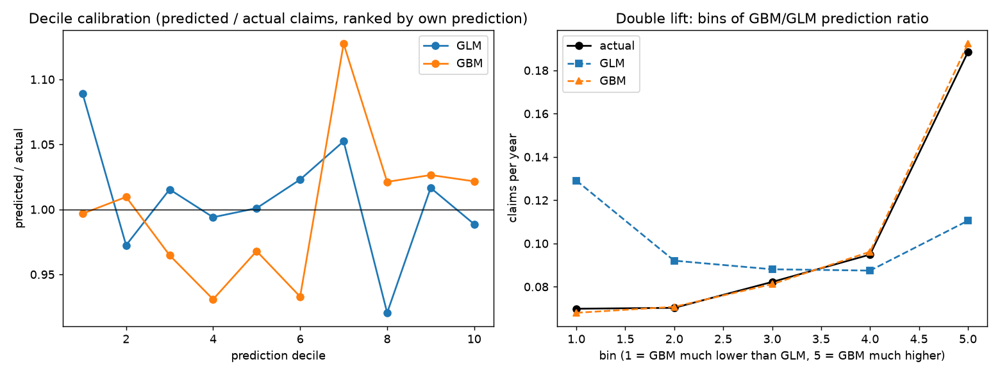

# Frequency: test-set results

Data: **real freMTPL2 (public)**  
Test policies: 135,602; claims: 7,177; exposure-years: 71,635  
GBM backend: `lightgbm`, 1882 trees, params {'leaves': 32, 'mcs': 200}  
Metric: mean Poisson deviance per policy (lower is better); constant rate = 0.1007 claims per year.

| model                       |   test_deviance |   deviance_explained |    bias |
|:----------------------------|----------------:|---------------------:|--------:|
| GLM (R)                     |         0.31145 |              0.05189 | 0.00108 |
| GBM (lightgbm)              |         0.30000 |              0.08675 | 0.00550 |
| Constant rate (train+valid) |         0.32850 |              0.00000 | 0.00531 |

Paired bootstrap, GLM minus GBM deviance: **+0.01145** (95% CI +0.01030 to +0.01274) -> GBM is better than GLM by more than sampling noise.

Paired bootstrap, constant minus GLM deviance: **+0.01705** (95% CI +0.01556 to +0.01867) -> GLM is better than constant by more than sampling noise.

Paired bootstrap, constant minus GBM deviance: **+0.02850** (95% CI +0.02644 to +0.03073) -> GBM is better than constant by more than sampling noise.

