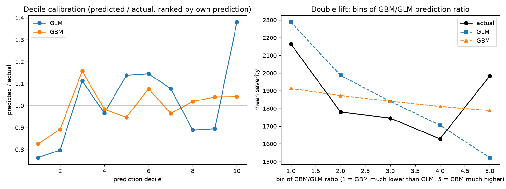

# Test-set results

Data: **real freMTPL2 (public)**  
Test policies with claims: 4,997; claims: 5,234  
GBM backend: `lightgbm`, 137 trees, params {'leaves': 4, 'mcs': 50}

| model              |   test_deviance |   deviance_explained |    bias |
|:-------------------|----------------:|---------------------:|--------:|
| GLM (R)            |          1.3333 |              -0.0056 |  0.0039 |
| GBM (lightgbm)     |          1.3247 |               0.0009 | -0.0090 |
| Constant (null_mu) |          1.3259 |               0.0000 |  0.0014 |

Paired bootstrap, GLM minus GBM deviance: **+0.0086** (95% CI -0.0157 to +0.0339) -> the difference is within sampling noise (95% CI includes 0).

Paired bootstrap, GLM minus constant deviance: **+0.0074** (95% CI -0.0207 to +0.0399) -> the difference is within sampling noise (95% CI includes 0).

Paired bootstrap, GBM minus constant deviance: **-0.0011** (95% CI -0.0206 to +0.0174) -> the difference is within sampling noise (95% CI includes 0).

